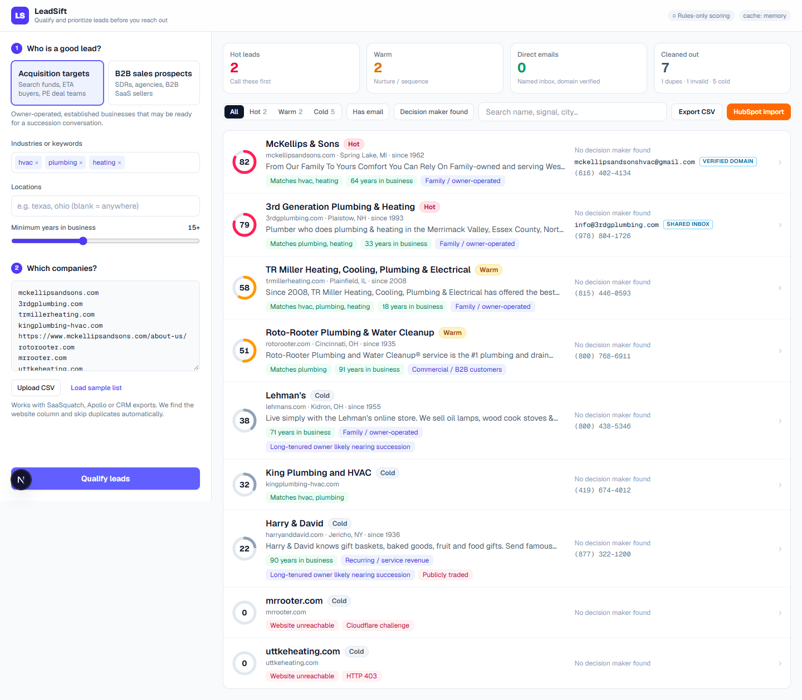

# LeadSift: qualify and prioritize leads before you reach out

A companion tool for [SaaSquatch Leads](https://www.saasquatchleads.com/). SaaSquatch is good at producing **lists**. LeadSift answers the next question every searcher and SDR asks: *which of these 300 companies should I call first, who do I ask for, and what do I say?*

Paste websites or drop in any CSV export (SaaSquatch, Apollo, a CRM). For each company LeadSift reads its public website, verifies who you can actually reach, scores the lead 0-100 against **your** ideal profile with the evidence behind every point, and exports the ranked list straight into HubSpot.



---

## Why this feature

| Problem with a raw scraped list | What LeadSift does |
|---|---|
| Hundreds of rows, no order. Reps work top-to-bottom. | Ranks every lead **Hot / Warm / Cold** against an ICP you define in 10 seconds. |
| "Score: 87" with no explanation, so reps don't trust it. | Every point maps to a visible signal with a quote from the site ("…family-owned and serving West Michigan since 1962…"). |
| Generic info@ addresses and dead domains. | Emails are classified as direct, shared inbox or pattern guess, with MX verification. Unreachable and bot-walled sites are flagged, not silently dropped. |
| Duplicates and junk rows waste credits and calls. | Normalizes URLs, emails and messy input into domains; removes duplicates and invalid rows before any request is made. |
| Searchers care about *succession*, not just contact info. | The **Acquisition targets** preset looks for owner-operated, multi-generation, long-tenured and recurring-revenue businesses, and penalizes franchises, PE-backed and public companies. |
| Leads die between the tool and the CRM. | One-click **HubSpot import CSV** (column names match HubSpot's default properties) plus a full CSV with the "why it ranks" and a suggested opener. |

Two personas are built in, matching SaaSquatch's users:

- **Acquisition targets**: search funds, ETA buyers and PE deal teams (Caprae's own use case).
- **B2B sales prospects**: SDRs, agencies and SaaS sellers (hiring, growth and "book a demo" signals).

## How a lead is qualified

```
domain ──► homepage (https → www → http fallback)
        ──► robots.txt check ──► up to 4 subpages (about, team, contact, careers)
        ──► extract: schema.org JSON-LD → mailto/tel links → page text regexes
              emails · phones · socials · people + titles · founding year · city/state · tech stack
        ──► verify emails: syntax · MX lookup · role-based · on-company-domain · pattern guess
        ──► rules score (fit 40 + reachability 30 + opportunity 30 − risks)
        ──► LLM (optional, Groq free tier or Claude): summary, fit score, reasons, risks, outreach opener
        ──► blended score (55% rules / 45% LLM) → tier
```

**Scoring is deliberately explainable.** The rules score works with no API key and every point is traceable. The LLM adds judgement that keywords miss (e.g. "this is a franchise location even though it doesn't say so"), and it can only move the score by its 45% weight. If the AI call fails (rate limit, bad key), the lead falls back to the rules score and isn't cached, so it retries on the next run.

## Architecture

| Layer | Choice | Why |
|---|---|---|
| Frontend | **Next.js 16 (App Router), React 19, TypeScript, Tailwind CSS v4** | One codebase for UI + API; typed end to end. |
| UX | Two-step guided setup → live streaming results → detail drawer | Leads appear as they finish (no 2-minute spinner); filters, search and export work on the visible set. |
| API | `POST /api/qualify`: **one domain per request**, Node.js runtime, `maxDuration` 60s | Each lead is its own short serverless invocation, so a 500-row list scales horizontally instead of hitting one function's time limit. The browser runs a 4-worker queue and can stop mid-run. |
| Hosting | **Vercel** (serverless Functions on Fluid Compute; static assets on Vercel's CDN), which runs on **AWS** | Zero-ops deploys, preview URL per branch, autoscaling functions. |
| Database / cache | **Neon serverless Postgres** (`@neondatabase/serverless` HTTP driver) in a `kv_cache` table (`key`, `jsonb value`, `expires_at`) | HTTP driver = no connection-pool exhaustion from many concurrent functions. Falls back to an in-memory LRU map when `DATABASE_URL` isn't set. |
| Caching | Pages: 7 days · robots.txt: 7 days · qualified leads: 24h, keyed by domain + ICP hash + pipeline version · MX lookups: in-process | Re-running a list, or the same domain appearing in two lists, is instant and free. Changing the ICP rescores without refetching pages. Failed fetches are never cached, so they retry next run. |
| AI | Pluggable. **Groq** (free tier, `openai/gpt-oss-120b`, strict JSON-schema output, retry-after aware) or **Claude Opus 5.5** (`@anthropic-ai/sdk`, structured outputs via Zod, effort `low`, server-side refusal fallback). Both are validated against the same Zod schema. | Free to run with Groq; switch to Claude for higher-quality judgement with one env var. No parsing hacks either way. |
| CLI | `npm run qualify` (tsx) reuses the exact same pipeline | Batch a CSV from the terminal or a cron job; no UI or server needed. |
| Scraping | Native `fetch` + **cheerio** | Fast and dependency-light; no headless browser needed for SMB marketing sites. |
| Deployment | GitHub → Vercel Git integration: every push gets a preview URL, `main` deploys to production | No manual steps; env vars are set in the Vercel dashboard. |

### Performance and reliability details

- 8s timeout and 1.5 MB cap per page; streaming reads stop at the cap.
- Retries only fast transient failures (429, 5xx, connection reset) with backoff. Timeouts and DNS failures fail fast instead of burning 50s.
- https → www → http fallback, stopping early when the failure won't change (bot wall, timeout).
- Subpages fetched in parallel; the four-worker client queue bounds load on any single site.
- Input is normalized and de-duplicated client-side before any request; internal hostnames (`.local`, `.internal`, …) are rejected server-side.

### Ethical data collection

- **robots.txt is honoured** for every subpage.
- The crawler identifies itself honestly (`LeadSiftBot/1.0`). **It does not spoof browsers, rotate IPs or solve CAPTCHAs.** Sites behind Cloudflare or bot walls are shown as "blocked" with the reason, so a rep can check them by hand.
- Only public business pages are read; no logins, no personal social profiles.
- Emails are verified with DNS (MX) only. SMTP "pinging" is unreliable against catch-all servers, is blocked on serverless hosts, and looks like abuse to the receiving server.
- Guessed emails are always labelled as guesses and are **excluded from the HubSpot export**.

## Run it locally

Requires Node 20+.

```bash
npm install
cp .env.example .env.local   # all keys are optional
npm run dev                   # http://localhost:3000
```

**Free AI scoring:** create a key at [console.groq.com/keys](https://console.groq.com/keys) and put it in `.env.local` as `GROQ_API_KEY=gsk_...`. The header shows which AI provider is active. Groq's free tier has a low tokens-per-minute cap, so large lists take a little longer.

### Command-line batch mode

```bash
npm run qualify -- scripts/sample-leads.csv --industries hvac,plumbing,heating --hubspot
```

```
LeadSift: 9 companies (1 duplicates, 1 invalid rows removed)
  [1/9] kingplumbing-hvac.com             32 cold
  [2/9] mckellipsandsons.com              82 hot
  ...
Hot 2 · Warm 2 · Cold 5 · 7.0s
Wrote scripts/sample-leads-ranked.csv
Wrote scripts/sample-leads-hubspot.csv
```

A larger, SaaSquatch-style export (17 rows, including duplicates and a junk row) is in `scripts/sample-saasquatch-export.csv`. You can also drag it onto the web app's input box.

Options: `--preset acquisition|sales`, `--industries`, `--locations`, `--min-years`, `--out`, `--hubspot`, `--concurrency`. Run `npm run qualify -- --help` for details.

Click **Load sample list** → **Qualify leads**. The sample is a realistic messy list: owner-run HVAC/plumbing companies mixed with a national chain, a franchise, a public brand, a bot-walled site, a duplicate URL and a junk row.

API demo:

```bash
curl -X POST http://localhost:3000/api/qualify \
  -H "Content-Type: application/json" \
  -d '{"domain":"mckellipsandsons.com","icp":{"preset":"acquisition","industries":["hvac","heating"],"locations":[],"minYears":15}}'
```

## Deploy

1. Push to GitHub and import the repo in Vercel (framework auto-detected).
2. Optional: add a Neon Postgres database from the Vercel Marketplace (sets `DATABASE_URL`) and add `GROQ_API_KEY` (free) or `ANTHROPIC_API_KEY`.
3. Deploy. The cache table is created automatically on first use.

## Project layout

```
src/app/page.tsx              UI shell, run queue, local persistence of the last run
src/app/api/qualify/route.ts  One-domain qualification endpoint (zod-validated)
src/components/               SetupPanel, ResultsView, LeadDrawer, small UI primitives
src/lib/fetcher.ts            Polite fetching, robots.txt, block detection, retries
src/lib/extract.ts            JSON-LD + HTML extraction of contacts, people, founding year, location, tech
src/lib/email.ts              MX verification, role/guess classification, confidence
src/lib/score.ts, presets.ts  Explainable scoring and the two personas
src/lib/ai.ts                 LLM qualification (Groq or Claude), schema-validated
scripts/qualify.ts            CLI batch mode (npm run qualify)
src/lib/cache.ts              Neon Postgres / in-memory cache
src/lib/exporters.ts          CSV + HubSpot export, CSV input parsing
```

## What I'd build next

- Push to HubSpot or Salesforce through their APIs instead of a CSV, with dedupe against existing CRM records.
- Watch lists: re-score saved leads weekly and alert when a signal changes (new "for sale" language, hiring spike, owner retirement post).
- More sources beyond the website: state business registries (formation date, registered owner), Google Business reviews (review count is a proxy for revenue), and LinkedIn headcount.
- Feedback loop: reps mark leads as good or bad and the rule weights tune themselves.
